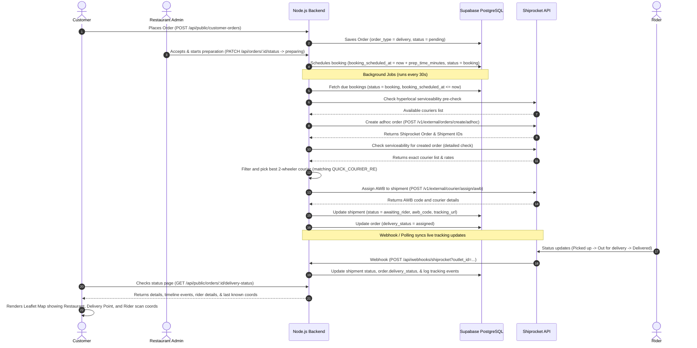

# Shiprocket Quick Hyperlocal Delivery Integration Analysis

This document provides a comprehensive technical analysis of the existing **Shiprocket Quick** integration implemented in the Banaoo Restaurant POS platform.

---

## 1. System Architecture & Lifecycle

The integration is built to automate hyperlocal 2-wheeler courier bookings (e.g., Dunzo, Rapido, Shadowfax, Borzo, etc.) using Shiprocket Quick (`SR_QUICK`). The system is fully event-driven with scheduling, automatic retries, active webhook tracking, and background polling.

### Order to Delivery Lifecycle Flowchart

---

## 2. Database Schema

The database relies on four tables defined in the migrations `20260611000001_shiprocket_delivery.sql` and `20260612000002_shiprocket_track_snapshot.sql`:

### `public.shiprocket_connections`
Stores encrypted Shiprocket Quick credentials and delivery parameters per outlet.
- **`outlet_id`**: UUID (Foreign Key to `public.outlets`, Unique)
- **`api_email_enc`**: Encrypted API user email (AES-256-GCM)
- **`api_password_enc`**: Encrypted API user password (AES-256-GCM)
- **`access_token_enc`**: Encrypted cached JWT access token (AES-256-GCM)
- **`token_expires_at`**: Expiration timestamp for the cached token (regenerated if within 24 hours of expiry)
- **`is_connected`**: Boolean flag indicating connection state
- **`settings`**: JSONB containing parameters:
  - `auto_delivery_enabled`: Enable automatic dispatching
  - `prep_time_minutes`: Minutes to wait before booking dispatch (default `15`)
  - `default_weight_kg`: Package weight (default `0.5`)
  - `dimensions`: Package dimensions (`length`, `width`, `height`)
  - `pickup_address`: Custom pickup location addresses (with latitude/longitude/pincode)
  - `pickup_location_name`: Register location name in Shiprocket panel (default `Primary`)
  - `cod_enabled`: Accept COD deliveries
  - `retry_max_attempts`: Max automatic retry attempts on failure (default `3`)
  - `retry_interval_seconds`: Seconds between retries (default `120`)
  - `webhook_secret`: Secret token to validate incoming Shiprocket webhooks

### `public.shiprocket_shipments`
Maps a Banaoo order to an active Shiprocket shipment.
- **`order_id`**: UUID (Foreign Key to `public.orders`, Unique)
- **`outlet_id`**: UUID
- **`shiprocket_order_id`**: Shiprocket order reference ID
- **`shipment_id`**: Shiprocket shipment reference ID
- **`awb_code`**: Tracking Air Waybill number
- **`courier_name`**: Name of the assigned carrier (e.g. Dunzo, Rapido, Shadowfax)
- **`tracking_url`**: Shiprocket public tracking link
- **`status`**: Current shipment state enum:
  - `not_booked`, `booking`, `shipment_created`, `awaiting_rider`, `rider_assigned`, `picked_up`, `out_for_delivery`, `delivered`, `cancelled`, `booking_failed`
- **`booking_scheduled_at`**: Timestamp scheduled for dispatch booking
- **`next_retry_at`**: Timestamp for next automatic booking retry
- **`last_track_snapshot`**: Cached JSONB snapshot from the tracking API containing coordinates, activities list, and rider agent details.

### `public.shiprocket_tracking_events`
Stores historical timeline logs of tracking activities.
- **`shipment_id`**: UUID (Foreign Key to `public.shiprocket_shipments`)
- **`event_code`** & **`event_message`**: Status labels and comments
- **`raw`**: JSONB response stored from webhook or API fetch

### `public.shiprocket_audit_log`
Tracks connection setup, dispatch actions, errors, and webhooks for troubleshooting.
- **`outlet_id`**, **`order_id`**: Context foreign keys
- **`action`**: e.g., `connection.connect`, `shipment.create`, `webhook.received`
- **`metadata`**: JSONB payload logs

---

## 3. Server Modules (`server/shiprocket/`)

The backend logic is modularized into several components registered under `server/index.js`:

| Module File | Purpose & Responsibilities |
| :--- | :--- |
| [`crypto.js`](file:///f:/banaoo---restaurant-pos/server/shiprocket/crypto.js) | Implements AES-256-GCM symmetric encryption for API credentials at rest using `SHIPROCKET_ENCRYPTION_KEY` (or `SESSION_SECRET` fallback). |
| [`client.js`](file:///f:/banaoo---restaurant-pos/server/shiprocket/client.js) | Handles HTTP communication with the Shiprocket API (`https://apiv2.shiprocket.in`). Implements auth login, adhoc order creation, serviceability checks, AWB assignment, shipment tracking, and cancellation. |
| [`auth.js`](file:///f:/banaoo---restaurant-pos/server/shiprocket/auth.js) | Handles connection setup, credential decryption, and token management (exposes `getValidToken()` which refreshes expired tokens transparently). |
| [`hyperlocal.js`](file:///f:/banaoo---restaurant-pos/server/shiprocket/hyperlocal.js) | Helper logic. Contains regex matching (`QUICK_COURIER_RE`) to prioritize 2-wheeler riders (e.g., Dunzo, Rapido) over cargo vehicles. |
| [`status-mapper.js`](file:///f:/banaoo---restaurant-pos/server/shiprocket/status-mapper.js) | Maps Shiprocket event statuses (e.g., `'AWB_ASSIGNED'`, `'IN TRANSIT'`) into standard internal shipment statuses and maps those to `orders.delivery_status` values (`'assigned'`, `'out_for_delivery'`, etc.). |
| [`delivery-service.js`](file:///f:/banaoo---restaurant-pos/server/shiprocket/delivery-service.js) | Core orchestration orchestrating scheduling, coordinate resolution, order JSON payload construction, courier selection logic, manual/automatic retries, and API tracking sync. |
| [`webhook.js`](file:///f:/banaoo---restaurant-pos/server/shiprocket/webhook.js) | Handles incoming Shiprocket webhook tracking payloads and processes public order delivery status requests. |
| [`jobs.js`](file:///f:/banaoo---restaurant-pos/server/shiprocket/jobs.js) | Implements a background runner executing every **30 seconds** containing four main processes: 1. `processDueBookings()`: Processes shipments scheduled past `booking_scheduled_at` using database `FOR UPDATE SKIP LOCKED`. 2. `processRetries()`: Processes failed bookings when `next_retry_at` is due. 3. `processTrackingPoll()`: Fallback tracking update sync for active shipments that haven't been updated in 2 minutes. 4. `refreshExpiringTokens()`: Auto-renews connection tokens about to expire within 24 hours. |
| [`routes.js`](file:///f:/banaoo---restaurant-pos/server/shiprocket/routes.js) | Express route handlers mapping to admin dashboard controllers (connection setup, retry booking, cancelling booking) and public webhook/status routes. |

---

## 4. Status Mapping Details

The system converts raw Shiprocket courier tracking status codes to Banaoo's simplified statuses to update the owner dashboard and the customer timeline.

### Shipment Status to Customer Label Map

| `shiprocket_shipments.status` | Mapped `orders.delivery_status` | Customer Timeline Stepper Label | Description |
| :--- | :--- | :--- | :--- |
| `not_booked` | `pending` | Order accepted | The order is accepted but delivery booking has not initiated. |
| `booking` | `pending` | Preparing your food | Dispatch is scheduled and waiting for the kitchen preparation time to pass. |
| `shipment_created` | `assigned` | Finding rider | Order is registered with Shiprocket, searching for courier agents. |
| `awaiting_rider` | `assigned` | Finding rider | Courier assigned or awaiting pick up. |
| `rider_assigned` | `assigned` | Rider assigned | Courier agent accepts shipment, heading to restaurant. |
| `picked_up` | `picked_up` | Food picked up | Rider has collected the parcel from the restaurant. |
| `out_for_delivery` | `out_for_delivery` | On the way | Rider is on their way to the delivery address. |
| `delivered` | `delivered` | Delivered | Shipment has been successfully delivered. |
| `booking_failed` | `failed` | Delivery booking failed | Dispatch booking encountered errors (e.g. unserviceable pin). |
| `cancelled` | `cancelled` | Cancelled | Order delivery cancelled. |

---

## 5. Front-End Integration

### Admin POS Panel
- **Settings Dashboard (`ShiprocketSettingsPanel.tsx`)**: Allows outlet managers to configure their Shiprocket Quick API user credentials, dimension packages, pickup GPS points, and auto-dispatch options.
- **Order Details (`OrderDeliveryPanel.tsx`)**: Rendered inside active delivery orders in the kitchen/cashier portal. Displays live timeline tracking logs, current courier assignment status, AWB, and buttons for **Retry booking** (if failed) or **Cancel shipment**.

### Customer Order Status Page
- **Delivery Stepper & Timeline (`CustomerDeliveryTimeline.tsx`)**: Displays a real-time progress bar (Accepted → Preparing → Rider Assigned → Picked Up → Delivered) and logs milestones with local timestamps.
- **Leaflet Map Integration (`DeliveryTrackingMap.tsx`)**:
  - Draws markers for the **Restaurant** and the customer's **Delivery address** based on stored GPS coordinate columns.
  - Dynamically updates the rider's **Last known position**: when a tracking event contains a textual scan location (e.g., `"New Delhi Hub"`), the client utilizes a forward geocoder (`src/lib/geocoding`) to resolve it to coordinates and pin it on the map with a dashed routing polyline.
  - Exposes quick actions like clicking the rider's phone number (`tel:`) or jumping to the external tracking page.
