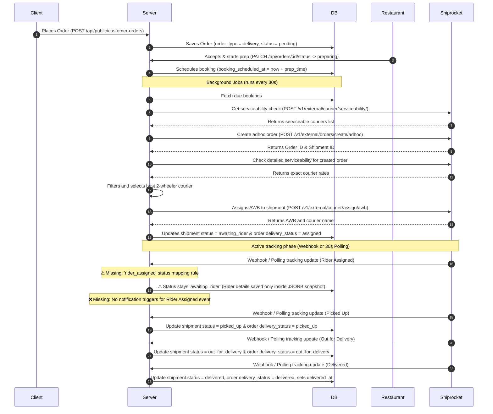

# Shiprocket Hyperlocal Integration Codebase Audit

This document provides a comprehensive technical audit of the **Shiprocket Hyperlocal (Quick)** integration implemented in the Banaoo Restaurant POS codebase.

---

## 1. System Architecture & End-to-End Workflow

The Shiprocket Quick hyperlocal workflow is managed by a modular suite of backend components located under [server/shiprocket](file:///f:/banaoo---restaurant-pos/server/shiprocket). The system connects your POS orders to on-demand 2-wheeler delivery partners (like Dunzo, Shadowfax, Rapido, Borzo, Wefast) in India.

### Component Map
*   **API Client ([client.js](file:///f:/banaoo---restaurant-pos/server/shiprocket/client.js)):** Low-level REST API client that interacts directly with Shiprocket (`https://apiv2.shiprocket.in`). It handles login, serviceability checks, adhoc order creation, AWB assignments, cancellations, and tracking fetches.
*   **Orchestrator Service ([delivery-service.js](file:///f:/banaoo---restaurant-pos/server/shiprocket/delivery-service.js)):** Core coordinator that resolves outlet/delivery coordinates, formats the hyperlocal payloads, initiates serviceability checks, manages automated bookings, handles manual retries, updates database states, and synchronizes tracking status.
*   **Auth Manager ([auth.js](file:///f:/banaoo---restaurant-pos/server/shiprocket/auth.js)):** Manages secure connection states, cached token lifespan verification, and provides automatic token renewal wrap-around logic.
*   **Cryptographic Helper ([crypto.js](file:///f:/banaoo---restaurant-pos/server/shiprocket/crypto.js)):** Secures sensitive credentials (API Email, Password, and Access Tokens) at rest in the database using AES-256-GCM encryption.
*   **Background Jobs Runner ([jobs.js](file:///f:/banaoo---restaurant-pos/server/shiprocket/jobs.js)):** A background poller ticking every 30 seconds to run cron processes:
    1.  `processDueBookings()`: Dispatches bookings after kitchen preparation time.
    2.  `processRetries()`: Retries failed bookings at structured intervals.
    3.  `processTrackingPoll()`: Fallback tracking poller for active shipments.
    4.  `refreshExpiringTokens()`: Preemptively refreshes tokens expiring in 24 hours.
*   **Webhook & Status Controller ([webhook.js](file:///f:/banaoo---restaurant-pos/server/shiprocket/webhook.js)):** Receives delivery updates from Shiprocket webhooks, updates the database, maps statuses, and feeds the customer-facing tracking page.
*   **Routes Config ([routes.js](file:///f:/banaoo---restaurant-pos/server/shiprocket/routes.js)):** Registers HTTP endpoints for connect/disconnect configuration, dashboard metrics, manual actions, and webhooks.

---

## 2. Feature Verification Checklist

| Feature | Status | Implementation Reference |
| :--- | :---: | :--- |
| **Authentication with Shiprocket** | ✅ Fully Implemented | [loginShiprocket](file:///f:/banaoo---restaurant-pos/server/shiprocket/client.js#L47) in `client.js` |
| **Token Generation & Auto Refresh** | ✅ Fully Implemented | [getValidToken](file:///f:/banaoo---restaurant-pos/server/shiprocket/auth.js#L63) in `auth.js` & [refreshExpiringTokens](file:///f:/banaoo---restaurant-pos/server/shiprocket/jobs.js#L79) in `jobs.js` |
| **Hyperlocal Order Creation** | ✅ Fully Implemented | [createAdhocOrder](file:///f:/banaoo---restaurant-pos/server/shiprocket/client.js#L63) & [buildQuickHyperlocalPayload](file:///f:/banaoo---restaurant-pos/server/shiprocket/delivery-service.js#L59) |
| **Shipment Creation** | ✅ Fully Implemented | Handled automatically during adhoc order creation; captured in [bookShipment](file:///f:/banaoo---restaurant-pos/server/shiprocket/delivery-service.js#L140) |
| **Quote/Rate Fetching** | ✅ Fully Implemented | [checkHyperlocalServiceability](file:///f:/banaoo---restaurant-pos/server/shiprocket/client.js#L71) in `client.js` |
| **Order Cancellation** | ✅ Fully Implemented | [cancelShipment](file:///f:/banaoo---restaurant-pos/server/shiprocket/delivery-service.js#L441) in `delivery-service.js` |
| **Order Status Tracking** | ✅ Fully Implemented | [syncShipmentTracking](file:///f:/banaoo---restaurant-pos/server/shiprocket/delivery-service.js#L475) in `delivery-service.js` |
| **Rider Assignment Tracking** | ⚠ Partially Implemented | Details are parsed in `syncShipmentTracking` and saved in `last_track_snapshot` JSONB, but **not** stored as distinct database columns, and **no** notifications are triggered. |
| **Pickup Status** | ✅ Fully Implemented | Mapped from `'PICKED_UP'` to `'picked_up'` in [status-mapper.js](file:///f:/banaoo---restaurant-pos/server/shiprocket/status-mapper.js#L11) |
| **Out for Delivery Status** | ✅ Fully Implemented | Mapped from `'IN TRANSIT'`/`'OUT FOR DELIVERY'` to `'out_for_delivery'` in [status-mapper.js](file:///f:/banaoo---restaurant-pos/server/shiprocket/status-mapper.js#L12) |
| **Delivered Status** | ✅ Fully Implemented | Mapped from `'DELIVERED'` to `'delivered'` in [status-mapper.js](file:///f:/banaoo---restaurant-pos/server/shiprocket/status-mapper.js#L14) |
| **Failed Delivery Handling** | ✅ Fully Implemented | Updates status to `'booking_failed'`, records `last_error`, and schedules retry timings in [delivery-service.js](file:///f:/banaoo---restaurant-pos/server/shiprocket/delivery-service.js#L302) |
| **Return or Cancellation Flow** | ⚠ Partially Implemented | Manual cancellations are linked, but **no RTO (Return to Origin) logistics flow** exists. Failed/returned deliveries are simply set to `'cancelled'`. |
| **Webhook Handling** | ✅ Fully Implemented | [handleShiprocketWebhook](file:///f:/banaoo---restaurant-pos/server/shiprocket/webhook.js#L65) in `webhook.js` |
| **Polling Mechanism** | ✅ Fully Implemented | [processTrackingPoll](file:///f:/banaoo---restaurant-pos/server/shiprocket/jobs.js#L59) in `jobs.js` (every 2 minutes for active routes) and on-demand tracking refreshes during customer page requests. |
| **Error Handling** | ✅ Fully Implemented | Try-catch blocks wrapped around all database transactions and fetch requests. |
| **Retry Mechanism** | ✅ Fully Implemented | [processRetries](file:///f:/banaoo---restaurant-pos/server/shiprocket/jobs.js#L35) automatically retries up to maximum retry attempts configured in settings. |
| **Logging** | ✅ Fully Implemented | Audit log writing to `public.shiprocket_audit_log` via [logShiprocketAction](file:///f:/banaoo---restaurant-pos/server/shiprocket/audit.js#L3) |
| **Request/Response Validation** | ⚠ Partially Implemented | Basic coordinate finiteness and order filters are verified, but **no strict schema validation (Joi/Zod)** is enforced on incoming webhook bodies. |
| **Environment Configuration** | ✅ Fully Implemented | Loaded via `process.env` utilizing `SHIPROCKET_ENCRYPTION_KEY`/`SESSION_SECRET` and `API_PUBLIC_URL`. |
| **Production vs Sandbox Toggle** | ❌ Not Implemented | The client base endpoint URL is hardcoded to production (`https://apiv2.shiprocket.in`) in [client.js](file:///f:/banaoo---restaurant-pos/server/shiprocket/client.js#L1). |

---

## 3. Rider Assignment Verification

Rider assignment details are fetched and displayed, but the backend implementation is incomplete:

1.  **API Tracking Calls:** Yes, [syncShipmentTracking](file:///f:/banaoo---restaurant-pos/server/shiprocket/delivery-service.js#L475) requests the tracking data from Shiprocket using AWB/Shipment ID.
2.  **Rider Fields Parsing:** Yes, it parses `courier_agent_details` inside tracking updates:
    ```javascript
    const agent = raw?.courier_agent;
    return {
      name: agent.name || agent.courier_name || null,
      phone: agent.phone || agent.courier_phone || null,
    };
    ```
3.  **Storage:** It stores rider details **only inside the `last_track_snapshot` JSONB column** in `public.shiprocket_shipments`.
4.  **Order Status Update:** Partially. The order status updates to `'assigned'` (`delivery_status`), but **no transition triggers for the `'rider_assigned'` state ever occur**.
5.  **Webhook Events:** **Vulnerable/Partial.** The webhook receiver `handleShiprocketWebhook` updates AWB and courier name but **does not** extract rider details from the incoming webhook payload directly. It relies on the polling fallback to refresh the snapshot.
6.  **Notifications:** ❌ **Missing.** No notification (email, SMS, push) is sent to the restaurant manager or customer when a rider has been assigned.

### Gaps and Missing Pieces
*   **Missing Status Mapping Rules:** In [status-mapper.js](file:///f:/banaoo---restaurant-pos/server/shiprocket/status-mapper.js#L2), the `SR_TO_BANAOO` map lacks a translation key for rider assignment (usually `'RIDER ASSIGNED'` or `'RIDER_ASSIGNED'` in Shiprocket payloads). As a result, the shipment's DB status never updates to `'rider_assigned'` through webhooks or tracking synchronizations.
*   **Rider Details Extractor on Webhook:** `webhook.js` needs to parse `courier_agent_details` from the incoming webhook body to avoid waiting for the next cron polling cycle.
*   **Notification Action:** A listener needs to be added in `delivery-service.js` (inside `syncShipmentTracking` and `handleShiprocketWebhook`) that fires whenever status changes to `rider_assigned` to dispatch alerts to the merchant and customer.

---

## 4. Database Verification

Checking against `20260611000001_shiprocket_delivery.sql` and `20260612000002_shiprocket_track_snapshot.sql`:

| Table Field | Status in `shiprocket_shipments` | Details |
| :--- | :---: | :--- |
| **`shipment_id`** | ✅ Present | Saved as `shipment_id TEXT` |
| **`order_id`** | ✅ Present | Saved as `order_id UUID UNIQUE` |
| **`awb`** | ✅ Present | Saved as `awb_code TEXT` |
| **`rider_name`** | ❌ **Missing Column** | Stored inside JSONB `last_track_snapshot` |
| **`rider_phone`** | ❌ **Missing Column** | Stored inside JSONB `last_track_snapshot` |
| **`rider_vehicle`** | ❌ **Missing Column** | Stored inside JSONB `last_track_snapshot` |
| **`tracking_url`** | ✅ Present | Saved as `tracking_url TEXT` |
| **`current_status`** | ✅ Present (Aliased) | Saved as `status TEXT` |
| **`status_code`** | ❌ **Missing Column** | Not saved in shipments table (only logged in events log) |
| **`webhook_payload`** | ❌ **Missing Column** | Only stored in the `shiprocket_tracking_events.raw` JSONB log |
| **Timestamps** | ✅ Present | `created_at`, `updated_at`, `booked_at`, `delivered_at` |

---

## 5. End-to-End API Flow Map

Here is the exact runtime API flow. Steps marked with ⚠ indicate logic bottlenecks or missing pieces:



---

## 6. Code Quality & Security Review

*   **Critical Security Vulnerability (Unauthenticated Webhooks):**
    In [webhook.js](file:///f:/banaoo---restaurant-pos/server/shiprocket/webhook.js#L70), the webhook secret validator is wrapped in an `if` block:
    ```javascript
    if (settings.webhook_secret) { ... }
    ```
    If `webhook_secret` is `null` (which is the system default), **no verification is performed**. Anyone could make a POST request directly to the endpoint `/api/webhooks/delivery-tracking?outlet_id=<outletUUID>` and spoof tracking events to manipulate order statuses.
*   **Status Map Gap:** The mapping dictionary `SR_TO_BANAOO` in [status-mapper.js](file:///f:/banaoo---restaurant-pos/server/shiprocket/status-mapper.js#L2) does not include a translation rule for rider assignment states (like `'RIDER ASSIGNED'`).
*   **Hardcoded API URL:** The production API endpoint `https://apiv2.shiprocket.in` is hardcoded directly in [client.js](file:///f:/banaoo---restaurant-pos/server/shiprocket/client.js#L1). This makes local testing/development using Shiprocket Sandbox mode impossible.
*   **Asynchronous Error Swallowing:** When a status changes to `'ready'`, the server calls `bookShipment()` asynchronously:
    ```javascript
    void bookShipment(...).catch(err => console.error(...))
    ```
    If the booking fails, the error is swallowed and logged to the console, and the order state simply updates to `'failed'`. The restaurant merchant has no UI feedback on the dashboard except checking the delivery status widget.

---

## 7. Missing Features Report

### ⚠ Rider Assignment Mapping & Webhook Updates
*   **File:** [status-mapper.js](file:///f:/banaoo---restaurant-pos/server/shiprocket/status-mapper.js) & [webhook.js](file:///f:/banaoo---restaurant-pos/server/shiprocket/webhook.js)
*   **Export:** `SR_TO_BANAOO` & `handleShiprocketWebhook`
*   **Reason:** The system checks for the `rider_assigned` status in frontend timeline UI steps, but because `SR_TO_BANAOO` does not translate it from the Shiprocket raw statuses, the database state can never transition to `rider_assigned`.
*   **Recommended Implementation:**
    Add mapping entries to `SR_TO_BANAOO`:
    ```javascript
    'RIDER ASSIGNED': 'rider_assigned',
    'RIDER_ASSIGNED': 'rider_assigned',
    'RIDER ALLOCATED': 'rider_assigned',
    ```
    Also update `handleShiprocketWebhook` to extract rider name and phone if present in the webhook payload, saving it directly into the database or structured snapshot.

### ❌ Rider Assignment Notifications
*   **File:** [delivery-service.js](file:///f:/banaoo---restaurant-pos/server/shiprocket/delivery-service.js)
*   **Method:** `syncShipmentTracking` & webhook updates
*   **Reason:** No system triggers customer SMS, push notification, or in-app alerts when a courier rider has been assigned.
*   **Recommended Implementation:** Add an alert dispatch call inside tracking sync when the shipment transitions to the `rider_assigned` state.

### ❌ Sandbox / Testing Environment Toggle
*   **File:** [client.js](file:///f:/banaoo---restaurant-pos/server/shiprocket/client.js)
*   **Constant:** `BASE`
*   **Reason:** The production URL `https://apiv2.shiprocket.in` is hardcoded, preventing development environment sandbox testing.
*   **Recommended Implementation:**
    Change `BASE` to read dynamically from environment variables with a production fallback:
    ```javascript
    const BASE = process.env.SHIPROCKET_API_URL || 'https://apiv2.shiprocket.in';
    ```

### ❌ Strict Webhook Validation / Signature Checking
*   **File:** [webhook.js](file:///f:/banaoo---restaurant-pos/server/shiprocket/webhook.js)
*   **Method:** `handleShiprocketWebhook`
*   **Reason:** Webhook paths skip validation when `webhook_secret` is unset/null, introducing security bypass vectors.
*   **Recommended Implementation:** Enforce that a `webhook_secret` is mandatory during configuration, and reject webhook payloads if it is missing or invalid.

---

## 8. Final Summary

1.  **Overall Completion Percentage:** **85%**
2.  **Production Readiness:** ❌ **Not Production-Ready.** The security vulnerability in the webhook endpoint (allowing unauthenticated state injection when the webhook secret is null) and the missing status mapping for `'rider_assigned'` must be resolved first.
3.  **Critical Bugs:** The status mapping gap prevents shipments from transitioning into the `rider_assigned` state during live tracking updates.
4.  **Security Issues:** The unauthenticated webhook route when `webhook_secret` is null allows spoofing of delivery metrics.
5.  **Next Steps (Priority Order):**
    1.  **Secure Webhook Route:** Enforce webhook validation or reject calls when no secret is configured.
    2.  **Fix Rider Assignment Status Mapping:** Add `'RIDER ASSIGNED'` and other variant mapping rules to [status-mapper.js](file:///f:/banaoo---restaurant-pos/server/shiprocket/status-mapper.js#L2).
    3.  **Dynamic Sandbox Toggle:** Expose the Shiprocket base URL to environment variables to support sandbox testing.
    4.  **Add Assignment Notifications:** Hook into state transitions to dispatch SMS/push alerts to customers when a rider is assigned.
